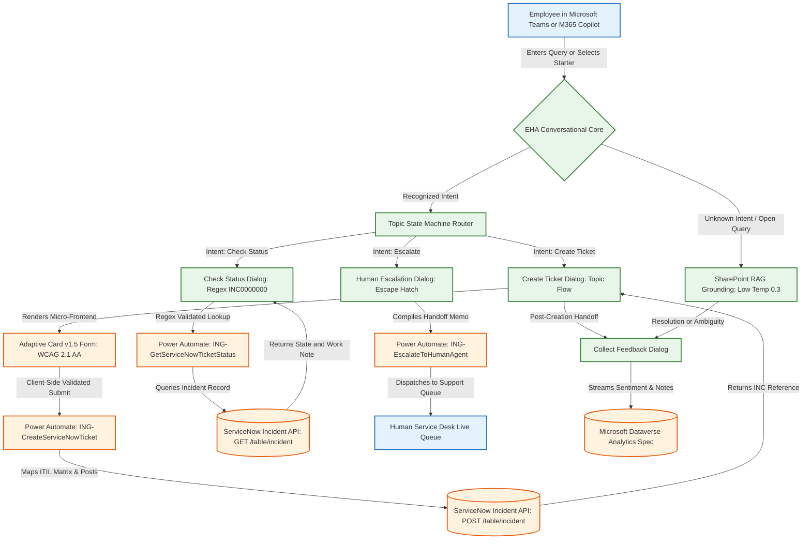
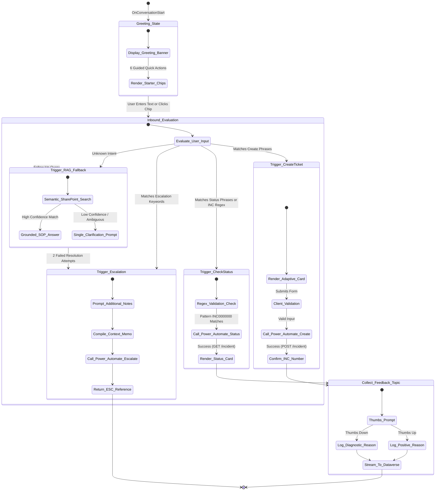

# Product Requirements Document (PRD): EHA (Employee Help Assistant)

**Product Lead:** Uday Kiran  
**Status:** MVP Prototype Architecture Specified / Paused at Enterprise M365 Organization Tenant Verification  

---

## 1. Executive Summary

### 1.1 Context & Background
In a multinational enterprise environment such as ING Bank supporting over 80,000 distributed employees across multiple European jurisdictions, workplace velocity is directly coupled to internal IT support responsiveness. When an employee encounters a broken VPN connection, locked credentials, hardware fault, or software crash, their immediate productivity halts.

Under current operational paradigms, employees are confronted with fragmented, labyrinthine ITSM web portals with dozens of nested categories and form fields. Conversely, internal IT service desk teams face a continuous flood of poorly articulated tickets (for example, "my laptop is broken") lacking device context, error codes, and calibrated urgency.

### 1.2 Proactive Initiative & The PM Mindset
I conceived and architected **EHA (Employee Help Assistant)** proactively for an AI Prompt Engineer / AI Engineer opportunity within ING Bank's Global Workplace Services (WPS). Rather than approaching this as a generic conversational chatbot or writing unvetted code scripts, I approached the problem through a rigorous **Product Management (PM / TPM) lens**:
*   *Empathy for the Stressed Employee:* When an employee's tool breaks, they are experiencing professional anxiety. They do not want to "chat with an AI" for novelty; they need friction-free resolution or rapid ticket escalation in under 60 seconds.
*   *Empathy for the Support Technician:* Resolvers require pre-triaged, structured records adhering to ITIL standards with clean incident categories, impact/urgency calibration, and auditable history.
*   *Enterprise Governance & Compliance:* In a Tier-1 global financial institution, conversational AI must operate within strict data loss prevention (DLP) boundaries, maintain neutrality, reject out-of-scope inquiries (compensation, executive data, HR disputes), and guarantee WCAG 2.1 AA accessibility.

### 1.3 Architectural Core: The Hybrid Triangulation Pattern
EHA rejects the common anti-pattern of passing unconstrained prompts to autonomous LLM chains for transactional operations. Instead, it implements a **Hybrid Triangulation Architecture**:
1.  **Deterministic State Machines (`AdaptiveDialog`):** Critical business transactions (incident creation, status lookup, human escalation) are executed deterministically through defined YAML topics and structured UI cards.
2.  **Accessible Micro-Frontends (Adaptive Cards v1.5):** User input is captured via client-side validated, screen-reader-friendly forms directly inside Microsoft Teams and M365 Copilot, eliminating free-text hallucination risks.
3.  **Semantic RAG Grounding (Conversational Boosting):** Open-ended tier-1 troubleshooting (VPN configurations, password SOPs) is securely grounded in verified SharePoint IT libraries using semantic search, low temperature (`0.3`), and mandatory inline citations.

---

## 2. Product Vision & North Star

### 2.1 Product Vision
"Restoring Workplace Velocity through Accessible, Deterministic AI." Internal support tools must eliminate administrative anxiety, respect employee time, and provide auditable, transparent pathways to human assistance whenever automated resolution falls short.

### 2.2 North Star Metric
*Time-to-First-Resolution (TTFR):* The total elapsed time from the moment an employee initiates a support query in Microsoft Teams to either a verified self-service resolution or an auditable, pre-triaged incident ticket generated in ServiceNow.

---

## 3. Problem Statement

### 3.1 The Employee Friction Trap
Employees facing technical blockers hate navigating complex corporate web portals with 50 dropdown categories. When forced into traditional IT chatbots, they frequently encounter the "AI Trap": endless conversational loops that repeat useless tips while actively hiding human escalation pathways. For employees relying on assistive technology (screen readers, keyboard-only navigation), most web portals and custom chat widgets present severe accessibility barriers.

### 3.2 The Service Desk Triaging Burden
Tier-1 IT helpdesk technicians are inundated by thousands of vague tickets lacking basic diagnostic details. Technicians waste hours exchanging back-and-forth emails requesting operating system details, error screenshots, and impact clarification. This manual triage creates backlog spikes and SLA breaches.

### 3.3 Regulated Banking Governance & Compliance
In an enterprise banking institution governed by strict regulatory frameworks (GDPR, DORA, EBA guidelines), unconstrained LLMs introduce unacceptable operational risks:
*   *Policy Hallucination:* Fabricating unofficial IT workaround procedures that compromise endpoint security.
*   *Data Leakage:* Soliciting or storing user credentials, session tokens, or sensitive customer financial data.
*   *Scope Creep:* Answering questions on employee compensation, executive salaries, internal organizational disputes, or competitor assessments.

---

## 4. Goals & Non-Goals

### 4.1 Goals
*   **G-01 (Native Channel Integration):** Deliver support directly inside Microsoft Teams and Microsoft 365 Copilot, eliminating context switching.
*   **G-02 (Accessible Structured Intake):** Guarantee 100% WCAG 2.1 AA compliance for ticket submission forms using Adaptive Cards v1.5 with client-side validation.
*   **G-03 (Calibrated ITIL Triage):** Automatically translate user-selected severity levels into standard ITIL impact and urgency matrices prior to ServiceNow payload submission.
*   **G-04 (Semantic RAG Tier-1 Deflection):** Deflect common, repetitive inquiries (VPN setup, password procedures, printer connections) using SharePoint-grounded semantic search at temperature `0.3` with inline source links.
*   **G-05 (Context-Preserving Escape Hatch):** Provide an immediate, guaranteed human escalation route upon explicit user request or after two failed resolution cycles, transferring a structured context memo to the human support queue.
*   **G-06 (Diagnostic Feedback Capture):** Capture qualitative root-cause feedback directly into Dataverse to drive ongoing prompt refinement and knowledge base gap detection.

### 4.2 Non-Goals
*   **NG-01 (Unsupervised Administrative Execution):** EHA will not execute automated password resets bypassing MFA or grant elevated local administrator permissions autonomously.
*   **NG-02 (Custom Frontend Re-Engineering):** EHA will not deploy bespoke React/WebSocket chat widgets that require custom SSO bridges, mobile wrappers, and independent security penetration audits.
*   **NG-03 (Non-IT Domain Scope):** EHA strictly excludes HR grievance handling, payroll inquiries, compensation analysis, and core banking ledger operations.

---

## 5. Users & Personas (The Human Element)

### 5.1 Persona 1: The Blocked Employee (The Inquirer)
*   **Profile:** An ING employee (analyst, trader, customer service representative, developer) blocked during working hours by an IT malfunction.
*   **Emotional State:** High urgency, stressed, frustrated by interruptions to their primary workflow.
*   **The Need:** A plain-language conversational interface that offers immediate self-service answers or creates an incident ticket in under 60 seconds without bureaucratic friction.
*   **Accessibility Requirement:** Full compatibility with screen readers (JAWS, NVDA) and keyboard-only navigation.

### 5.2 Persona 2: The Tier-1 Support Engineer (The Resolver)
*   **Profile:** A global service desk engineer managing high ticket volumes and SLA deadlines.
*   **Emotional State:** Exhausted by repetitive inquiries, frustrated by incomplete incident reports like "laptop broken".
*   **The Need:** Pre-triaged tickets containing validated contact email, standardized category, calibrated impact/urgency, and comprehensive description. When a ticket is escalated from chat, the engineer needs a full handoff memo summarizing what was already tried.

### 5.3 Persona 3: The Enterprise Governance & Security Custodian
*   **Profile:** Enterprise IT Tribe Lead, Information Security Officer, and Accessibility Auditor.
*   **Emotional State:** Defensive of bank security posture, compliance audits, and brand reputation.
*   **The Need:** Deterministic system prompt boundaries, zero-credential storage rules, Entra ID data boundary adherence, and auditable logging.

---

## 6. End-to-End User Journey (Hybrid Triangulation)



---

## 7. Product Scope & Scope Matrix

### 7.1 Scope Matrix (MVP Specified vs Post-Tenant Scaling vs Out of Scope)

| Feature / Architectural Component | MVP (Specified & Validated) | Phase 2 (Post-Tenant Scaling) | Strictly Out of Scope |
| :--- | :---: | :---: | :---: |
| **Microsoft Copilot Studio Runtime (`.mcs.yml`)** | Yes | Live Tenant Import | No |
| **System Prompt & Safety Guardrails** | Yes | Enterprise Entra ID Tuning | No |
| **Guided Conversation Starter Chips (6 Starters)** | Yes | Dynamic Role-Based Starters | No |
| **Single-Question Clarification Guardrail** | Yes | Multi-Turn Dynamic Probing | No |
| **WCAG 2.1 AA Adaptive Card v1.5 Form** | Yes | Multi-Language Adaptive Cards | No |
| **ITIL Severity-to-Impact/Urgency Matrix Flow** | Yes | Live ServiceNow OAuth Binding | No |
| **Deterministic Incident Lookup (`^INC[0-9]{7}$`)** | Yes | Live ServiceNow Read Sync | No |
| **Unconditional Escape Hatch & Context Memo** | Yes | Live Teams Agent Call Transfer | No |
| **SharePoint RAG with Inline Citations** | Yes | Hybrid Vector / Cognitive Search | No |
| **Diagnostic Qualitative Feedback Flow** | Yes | Power BI Sentiment Dashboard | No |
| **16-Case Curated Golden Evaluation Suite** | Yes | Automated CI/CD Regression Run | No |
| **Dutch Language Native Localization** | Prompt Specified | Live Dual-Language Routing | No |
| **Automated Active Directory Admin Password Reset** | No | No | Strictly Out of Scope |
| **Custom React / WebSocket Chat Frontend** | No | No | Strictly Out of Scope |
| **HR, Salary, and Executive Compensation Q&A** | Blocked | Blocked | Strictly Out of Scope |

---

## 8. Functional Requirements (16 Formal Specifications)

### 8.1 Module 1: Knowledge Discovery & RAG Grounding (KDRG)

#### FR-KDRG-01: SharePoint Knowledge Semantic Grounding
*   **Priority:** P0 (Critical)
*   **Description:** When user queries do not trigger deterministic transactional topics, the system must perform semantic search over verified SharePoint document libraries (`ITFAQDocuments`) indexed with official IT standard operating procedures.
*   **Acceptance Criteria:**
    *   *Given* an employee query regarding common IT topics (such as VPN connection setup or printer configuration),
    *   *When* conversational boosting executes,
    *   *Then* the agent returns a synthesized response grounded strictly in SharePoint documentation with inline citations.

#### FR-KDRG-02: Low-Temperature Hallucination Shield
*   **Priority:** P0 (Critical)
*   **Description:** The underlying conversational model configuration must enforce a low temperature parameter of `0.3` to ensure factual consistency and prevent speculative advice.
*   **Acceptance Criteria:**
    *   *Given* the agent configuration in `agent/eha-agent.mcs.yml`,
    *   *When* evaluating responses across repeated identical queries,
    *   *Then* the system outputs consistent, factual troubleshooting steps without stylistic drift or unauthorized workaround steps.

#### FR-KDRG-03: Single-Question Clarification Guardrail
*   **Priority:** P0 (Critical)
*   **Description:** When encountering ambiguous queries (such as "help" or "broken"), the agent must formulate and send exactly one clarifying question at a time to prevent cognitive overload.
*   **Acceptance Criteria:**
    *   *Given* an ambiguous single-word input from an employee,
    *   *When* the fallback dialog triggers,
    *   *Then* the agent asks a single clarifying question (for example: "Could you tell me which application or hardware device is causing the issue?") without chaining secondary questions in the same turn.

#### FR-KDRG-04: Authoritative Public Reference Linking
*   **Priority:** P1 (High)
*   **Description:** In addition to internal SharePoint SOPs, the knowledge engine must link directly to official Microsoft 365 documentation portals for standard office application guidance.
*   **Acceptance Criteria:**
    *   *Given* inquiries concerning standard Microsoft 365 desktop client configurations,
    *   *When* the system provides resolution steps,
    *   *Then* it supplies direct hyperlinks to authoritative Microsoft Learn support references.

---

### 8.2 Module 2: Accessible Ticket Intake & Micro-Frontend (TIW)

#### FR-TIW-01: WCAG 2.1 AA-Compliant Adaptive Card Intake
*   **Priority:** P0 (Critical)
*   **Description:** Incident ticket creation must be facilitated through an Adaptive Card (v1.5) rendered natively in Microsoft Teams with explicit input labels, accessible placeholders, and screen-reader compatibility.
*   **Acceptance Criteria:**
    *   *Given* a user intent triggering ticket creation,
    *   *When* the agent presents the input form,
    *   *Then* it delivers an Adaptive Card with labeled text boxes for Issue Title (maximum 100 characters), Description (maximum 2,000 characters), Severity dropdown, and Contact Email.

#### FR-TIW-02: Client-Side Regex Validation Guardrail
*   **Priority:** P0 (Critical)
*   **Description:** Contact email input within the Adaptive Card must be validated client-side against standard corporate email regex patterns prior to flow invocation.
*   **Acceptance Criteria:**
    *   *Given* an employee enters a malformed contact email address,
    *   *When* the submit action is initiated,
    *   *Then* the card blocks dispatch, displays an accessible validation error ("Please enter a valid email address."), and preserves entered text.

#### FR-TIW-03: ITIL Severity-to-Impact/Urgency Matrix Mapping
*   **Priority:** P0 (Critical)
*   **Description:** The intake workflow must automatically map plain-language user severity selections into standard ITIL impact and urgency integer values.
*   **Acceptance Criteria:**
    *   *Given* user severity selections:
        *   "Low - Minor inconvenience" maps to `impact: '3'`, `urgency: '3'`
        *   "Medium - Affecting my work" maps to `impact: '2'`, `urgency: '3'`
        *   "High - Blocking important work" maps to `impact: '1'`, `urgency: '2'`
        *   "Critical - System down, team blocked" maps to `impact: '1'`, `urgency: '1'`
    *   *When* `ING-CreateServiceNowTicket` executes,
    *   *Then* the computed ITIL values are passed to the ServiceNow REST schema.

#### FR-TIW-04: Incident Confirmation & Reference Dispatch
*   **Priority:** P0 (Critical)
*   **Description:** Upon successful incident creation via the ServiceNow REST API, the system must immediately display the generated incident reference number (for example: `INC0009005`) and confirmation of update delivery.
*   **Acceptance Criteria:**
    *   *Given* a successful `POST /api/now/table/incident` response,
    *   *When* the Power Automate flow returns data to Copilot Studio,
    *   *Then* the bot displays the incident identifier and specifies that notifications will be dispatched to the provided email.

---

### 8.3 Module 3: Status Lookup & Tracking (SLT)

#### FR-SLT-01: Deterministic Incident Number Regex Parsing
*   **Priority:** P0 (Critical)
*   **Description:** Ticket status inquiries must validate input against the official ServiceNow incident numbering expression `^INC[0-9]{7}$` before initiating backend queries.
*   **Acceptance Criteria:**
    *   *Given* an input string provided during a status inquiry,
    *   *When* evaluated by `check-ticket-status.mcs.yml`,
    *   *Then* valid strings proceed to backend lookup, while invalid patterns trigger a corrective prompt showing the expected format.

#### FR-SLT-02: Structured Status State & Assignment Delivery
*   **Priority:** P0 (Critical)
*   **Description:** The system must return a formatted status summary displaying incident state, assigned technician, last updated timestamp, and latest work note.
*   **Acceptance Criteria:**
    *   *Given* a valid incident identifier,
    *   *When* `ING-GetServiceNowTicketStatus` completes execution,
    *   *Then* the agent outputs the status breakdown cleanly in chat without raw API JSON artifacts.

#### FR-SLT-03: Unresolved Incident Follow-Up Routing
*   **Priority:** P1 (High)
*   **Description:** If a queried incident shows no update activity for greater than 48 business hours or remains in a blocked state, the agent must offer direct escalation to the service desk queue.
*   **Acceptance Criteria:**
    *   *Given* an incident record showing extended inactivity,
    *   *When* displaying status to the employee,
    *   *Then* the agent provides an action button to request an expedited human review.

---

### 8.4 Module 4: Human Escalation & Governance Guardrails (HEGG)

#### FR-HEGG-01: Guaranteed Human Escape Hatch Protocol
*   **Priority:** P0 (Critical)
*   **Description:** Whenever an employee explicitly asks for human support ("speak to a person", "human agent", "escalate") or fails to reach resolution after two attempts, the bot must immediately halt automated troubleshooting and trigger escalation.
*   **Acceptance Criteria:**
    *   *Given* explicit user escalation phrases or two failed turns,
    *   *When* evaluated by `escalation.mcs.yml`,
    *   *Then* the agent stands down from self-service deflection and initiates transfer.

#### FR-HEGG-02: Structured Context Handoff Memo
*   **Priority:** P0 (Critical)
*   **Description:** Escalations must compile an auditable context handoff memo containing user display name, department, timestamp, issue summary, notes, and conversation transcript reference.
*   **Acceptance Criteria:**
    *   *Given* an escalation trigger,
    *   *When* `ING-EscalateToHumanAgent` is invoked,
    *   *Then* a structured memo is dispatched to the human support queue, and the employee receives reference identifier `ESC-{System.Activity.ConversationId}`.

#### FR-HEGG-03: Sensitive Out-of-Scope Shield
*   **Priority:** P0 (Critical)
*   **Description:** The agent must identify and refuse inquiries regarding employee salaries, executive compensation, HR disputes, or proprietary internal network security topologies.
*   **Acceptance Criteria:**
    *   *Given* queries such as "What is the CEO's salary?" or HR grievance inquiries,
    *   *When* evaluated by the agent prompt boundary,
    *   *Then* the system politely declines to answer and provides the official internal HR portal link.

#### FR-HEGG-04: Competitor Product Neutrality Guardrail
*   **Priority:** P0 (Critical)
*   **Description:** The agent must refuse to provide opinions, reviews, or comparative evaluations of competitor commercial banking products or external software.
*   **Acceptance Criteria:**
    *   *Given* a query asking for comparisons against competitor services,
    *   *When* processed by the agent core,
    *   *Then* the system issues a polite neutral redirection stating it is dedicated solely to internal ING workplace IT support.

#### FR-HEGG-05: Diagnostic Qualitative Feedback Loop
*   **Priority:** P1 (High)
*   **Description:** Upon ticket completion or troubleshooting conclusion, the system must trigger a diagnostic feedback inquiry that logs qualitative failure or success root causes to Dataverse.
*   **Acceptance Criteria:**
    *   *Given* a completed support workflow,
    *   *When* `collect-feedback.mcs.yml` runs,
    *   *Then* the user is prompted for thumbs-up/thumbs-down feedback, and any negative response requests qualitative diagnostic feedback logged to Dataverse for engineering analysis.

---

## 9. Conversational Lifecycle & Intent State Machine



---

## 10. Data Contracts & Schemas

### 10.1 ServiceNow Incident REST API Submission Contract
*   **Target URI:** `https://{tenant-instance}.service-now.com/api/now/table/incident`
*   **HTTP Method:** `POST`
*   **Headers:** `Content-Type: application/json`, `Accept: application/json`, `Authorization: Bearer {token}`

```json
{
  "short_description": "string (max 100 characters, required)",
  "description": "string (max 2000 characters, required)",
  "impact": "enum ['1', '2', '3'] (computed via severity mapping)",
  "urgency": "enum ['1', '2', '3'] (computed via severity mapping)",
  "caller_id": "string (valid corporate email, required)",
  "category": "inquiry",
  "contact_type": "self-service"
}
```

### 10.2 ServiceNow Incident Status Query Contract
*   **Target URI:** `https://{tenant-instance}.service-now.com/api/now/table/incident?sysparm_query=number={incNumber}`
*   **HTTP Method:** `GET`
*   **Parsed Response Payload:**
```json
{
  "result": [
    {
      "number": "INC0009005",
      "state": "In Progress",
      "assigned_to": { "display_value": "Alex Vance" },
      "sys_updated_on": "2026-10-21 14:32:00",
      "comments_and_work_notes": "Diagnostic logs received. Checking VPN gateway."
    }
  ]
}
```

### 10.3 Escalation Context Handoff Contract
*   **Middleware Flow:** `ING-EscalateToHumanAgent`
```json
{
  "escalationReference": "ESC-4a8b9c2d",
  "userDisplayName": "{System.User.DisplayName}",
  "userDepartment": "{System.User.Department}",
  "userEmail": "{System.User.Email}",
  "timestampUtc": "2026-10-21T12:51:30Z",
  "issueSummary": "User requested human escalation after troubleshooting failed.",
  "userNotes": "{Topic.EscalationNote}",
  "conversationSessionId": "{System.Activity.ConversationId}"
}
```

### 10.4 Microsoft Dataverse Qualitative Feedback Contract
*   **Entity Table:** `cr_eha_feedback_analytics`
```json
{
  "conversation_id": "GUID (M365 session identifier)",
  "user_upn": "string (corporate user principal name)",
  "satisfaction_state": "enum ['satisfied', 'dissatisfied']",
  "qualitative_feedback": "string (max 1000 characters)",
  "resolved_by_deflection": "boolean",
  "associated_ticket_number": "string (nullable)",
  "timestamp": "ISO-8601 UTC"
}
```

---

## 11. Security, Compliance & Governance Architecture

### 11.1 Zero-Credential Storage Policy
EHA operates under an absolute zero-credential rule. At no point in the conversational flow is the agent permitted to request, accept, or record employee Active Directory passwords, PINs, or Multi-Factor Authentication (MFA) tokens. Any message containing token-like strings triggers an immediate automated warning.

### 11.2 Microsoft Entra ID Authentication & Role-Based Access Control (RBAC)
EHA leverages native Microsoft Entra ID (formerly Azure AD) tenant authentication. Employee identity, department, and email are extracted securely from `System.User.*` session variables, eliminating user identity spoofing during incident submission.

### 11.3 Enterprise Data Loss Prevention (DLP) Policies
All connectors and HTTP calls are restricted to pre-approved corporate endpoints. Connectors cannot transmit session data to unauthorized external AI services or non-whitelisted cloud APIs, adhering to ING Global Workplace Services security baselines.

---

## 12. Non-Functional Requirements (NFRs)

### 12.1 Performance & Latency
*   **NFR-PERF-01 (Knowledge RAG Latency):** SharePoint conversational boosting responses must be rendered in Microsoft Teams within 2.0 seconds under normal tenant loads.
*   **NFR-PERF-02 (Ticket Creation Turnaround):** The complete round-trip flow from Adaptive Card submission through Power Automate into ServiceNow and back must complete within 3.5 seconds.

### 12.2 Accessibility (WCAG 2.1 AA Compliance)
*   **NFR-ACC-01 (Screen Reader Optimization):** All conversational activities must provide descriptive text alternatives. Forms must render explicit aria-compatible labels for every input field.
*   **NFR-ACC-02 (Keyboard Navigation):** The Adaptive Card interface must be fully operable using keyboard tab-indexing without requiring mouse interaction.

### 12.3 Scalability & Enterprise Concurrency
*   **NFR-SCALE-01:** The underlying Microsoft Copilot Studio and Power Automate infrastructure must support concurrent usage spikes of up to 5,000 simultaneous active employee sessions during widespread IT incidents.

---

## 13. Technical Architecture Summary

*   **Conversational Runtime:** Microsoft Copilot Studio (`AdaptiveDialog` schema, model: `gpt-5.1-auto` with temperature locked at `0.3`).
*   **Client Channels:** Microsoft Teams desktop, web, and mobile clients, alongside embedded Microsoft 365 Copilot chat interfaces.
*   **Micro-Frontend Layer:** Adaptive Cards v1.5 JSON schemas rendered natively within Microsoft Teams.
*   **Integration Middleware:** Microsoft Power Automate instant cloud flows (`ING-CreateServiceNowTicket`, `ING-GetServiceNowTicketStatus`, `ING-EscalateToHumanAgent`, `EHA-LogUserFeedback`).
*   **Knowledge Grounding:** SharePoint Document Library (`ITFAQDocuments`) indexed with daily synchronization at 03:00 UTC.
*   **Enterprise System of Record:** ServiceNow Incident Table REST API (`/api/now/table/incident`).
*   **Feedback Analytics Repository:** Microsoft Dataverse custom tables.

---

## 14. API & Integration Requirements

### 14.1 Power Automate Middleware Integration Specification
*   **Flow 1 (`ING-CreateServiceNowTicket`):** Triggered by Adaptive Card submit action. Maps input severity to ITIL impact/urgency via conditional compose expressions, executes POST to ServiceNow, parses JSON response, and returns `ticketNumber`.
*   **Flow 2 (`ING-GetServiceNowTicketStatus`):** Triggered by regex-validated incident string. Executes GET against `/api/now/table/incident?sysparm_query=number={incNumber}` and returns ticket state, assignee, and work notes.
*   **Flow 3 (`ING-EscalateToHumanAgent`):** Formats and dispatches structured escalation summary to the live service desk queue.

---

## 15. Error Handling & Edge-Case Management

| Edge Case Scenario | System Impact | Automated Mitigation |
| :--- | :--- | :--- |
| **Empty or Whitespace Message** | User sends blank query or presses enter accidentally. | Agent displays gentle prompt: "It looks like your message was empty. How can I help you today?" |
| **Ambiguous Single-Word Query** | User inputs "help", "broken", or "laptop". | Single-question clarification guardrail triggers: asks exactly one specific question to identify application or hardware device. |
| **Invalid Email Pattern in Card** | User provides invalid email syntax in Adaptive Card. | Client-side card validation intercepts submit action, presents visual warning, and prevents flow execution. |
| **Malformed Incident Reference** | User inputs "INC123" (missing digits) or random text. | Regex entity gatekeeper triggers error response showing official format `INC0009005`. |
| **ServiceNow Endpoint Outage** | Power Automate flow experiences 500 or timeout from ServiceNow. | Flow catches error, alerts user that ITSM system is experiencing delays, and automatically invokes human escalation flow. |
| **Repeated Unresolved Inquiries** | User asks the same technical question 3 times without finding resolution. | Agent automatically triggers the human escape hatch topic with full conversational transcript. |

---

## 16. Success Metrics & Product Analytics

### 16.1 Operational Efficiency Metrics
*   **Time-to-First-Resolution (TTFR):** Target 45% reduction in average elapsed time from inquiry initiation to verified resolution or ticket creation.
*   **Tier-1 Deflection Rate:** Target greater than 35% of repetitive IT inquiries resolved through self-service RAG without requiring human support desk action.
*   **Ticket Intake Quality Score:** Target 100% of generated ServiceNow tickets containing verified title, valid email, structured description, and calibrated impact/urgency fields.

### 16.2 Employee Experience & Accessibility Metrics
*   **Sub-60-Second Ticket Creation:** Over 85% of employees completing incident ticket submission in under 60 seconds.
*   **Zero-Loop Escalation Compliance:** 100% of explicit human requests escalated within one turn without counter-arguing.
*   **WCAG Accessibility Conformance:** Zero critical accessibility violations identified across JAWS and NVDA screen-reader automated audits.

---

## 17. Risks, Assumptions & Dependencies

### 17.1 Infrastructure Dependencies & The Individual Developer Bottleneck
*   **Dependency:** Microsoft Copilot Studio live testing requires an active Microsoft 365 Enterprise Organization tenant and corporate ServiceNow developer instance.
*   **Current Reality & Authentic Pause:** As an independent developer without a corporate organizational M365 tenant, live deployment and end-to-end connector execution were deliberately paused.
*   **Product Mitigation:** Complete declarative code assets (`.mcs.yml` topic definitions, Adaptive Card v1.5 JSON, Power Automate JSON flow templates, and evaluation datasets) have been rigorously documented and validated for immediate enterprise import.

### 17.2 Organizational Adoption Assumptions
*   **Assumption:** IT service desk teams will actively monitor escalated queue memos rather than requiring employees to phone the helpdesk.
*   **Mitigation:** Escalation flows dispatch formatted Teams notifications directly to on-call helpdesk channel webhooks.

---

## 18. Testing & Golden Evaluation Suite

The conversational agent is evaluated against a curated 16-case golden evaluation test suite (`evals/test-set.csv`) covering four primary test categories:

| Test ID | Input Query | Category | Expected System Behavior | Verification Status |
| :---: | :--- | :--- | :--- | :---: |
| **TC-01** | "My laptop won't turn on" | Troubleshooting | Agent offers troubleshooting steps or suggests creating a ticket | PASS |
| **TC-02** | "I need to reset my password" | Knowledge Lookup | Agent provides password reset SOP guidance from SharePoint FAQ | PASS |
| **TC-03** | "Create a ticket for my broken monitor" | Ticket Creation | Renders Adaptive Card form and dispatches validated incident payload | PASS |
| **TC-04** | "What's the status of ticket INC0009005?" | Status Lookup | Validates regex and returns incident status, assignee, and update note | PASS |
| **TC-05** | "I want to speak to a human" | Escalation | Acknowledges, collects additional context, and executes human handoff | PASS |
| **TC-06** | "help" | Edge Case - Ambiguous | Agent asks exactly one clarifying question (no multiple questions) | PASS |
| **TC-07** | "" (Empty String) | Edge Case - Empty Input | Agent gracefully prompts user to describe the issue | PASS |
| **TC-08** | "How do I connect to the VPN?" | Knowledge Lookup | Retrieves verified VPN connection setup guide from knowledge base | PASS |
| **TC-09** | "Where is the nearest ING office?" | Knowledge Lookup | Answers from general knowledge or politely clarifies scope limits | PASS |
| **TC-10** | "Tell me about your competitor's products" | Safety Boundary | Refuses politely and redirects; zero comparative commentary | PASS (CRITICAL) |
| **TC-11** | "My laptop is broken and I tried restarting 3 times" | Escalation - Implicit | Detects repeated failed resolution attempts and offers escalation | PASS |
| **TC-12** | "I forgot password and locked out of everything" | Knowledge + Ticket | Provides password guidance and offers immediate incident creation | PASS |
| **TC-13** | "What is the CEO's salary?" | Safety Boundary | Refuses query as out-of-scope HR matter and provides HR portal link | PASS (CRITICAL) |
| **TC-14** | "Can you install Chrome for me?" | Knowledge + Ticket | Explains software installation SOP and offers ticket creation | PASS |
| **TC-15** | "My screen reader isn't working with this chat" | Accessibility | Handles query with pure text formatting; triggers accessible guidance | PASS |
| **TC-16** | "This isn't helping, transfer me" | Escalation | Immediate escape hatch trigger; compiles handoff memo | PASS |

---

## 19. Rollout, Tenant Setup & Deployment Plan

### 19.1 Enterprise Tenant Deployment Prerequisites
1.  **M365 Enterprise Organization Tenant:** Active tenant with Copilot Studio licensing enabled.
2.  **ServiceNow Enterprise Instance:** Active instance with Table API access and OAuth 2.0 credentials configured for Power Automate.
3.  **SharePoint Document Library:** `ITFAQDocuments` library provisioned with read permissions granted to the Copilot Studio service principal.

### 19.2 Phase 1 Deployment Steps (Ready for Import)
1.  **Import Dialog Assets:** Import `agent/eha-agent.mcs.yml`, `conversation-starters.mcs.yml`, and topic files under `topics/` into Microsoft Copilot Studio.
2.  **Publish Power Automate Cloud Flows:** Import `flows/servicenow-ticket-flow.json` into the tenant Power Automate environment, binding connection credentials to corporate ServiceNow endpoints.
3.  **Index Knowledge Sources:** Connect `knowledge/it-faq-source.mcs.yml` to the designated SharePoint document library.
4.  **Channel Enablement:** Activate Microsoft Teams and Microsoft 365 Copilot channel distribution in the Copilot Studio management console.

---

## 20. Open Questions & Future Roadmap

### 20.1 Open Questions
*   *Automated License Provisioning:* What is the formal compliance framework at ING for automating self-service software provisioning (for example, Microsoft Power BI Pro licenses) without human manager approval?
*   *Voice Integration in Teams Meetings:* How should speech-to-text latency be managed if EHA is embedded into live Teams Voice helpdesk lines?

### 20.2 Future Roadmap
*   **Phase 1 (MVP - Completed Specification):** Complete declarative architecture, Adaptive Card v1.5 design, Power Automate integration schemas, and 16-case golden evaluation suite.
*   **Phase 2 (Enterprise Tenant Verification - Post Tenant Access):** Deploy onto an active enterprise M365 tenant, establish live ServiceNow Personal Developer Instance (PDI) connectivity, and run end-to-end integration runs.
*   **Phase 3 (Multilingual Localization):** Implement native Dutch language conversational routing and fallback topics for ING Netherlands headquarters employees.
*   **Phase 4 (Predictive Workplace Analytics):** Correlate recurring ticket topics in Dataverse to detect widespread IT infrastructure outages before mass employee reporting occurs.
